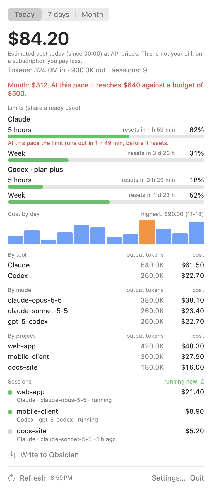

# AI Usage Meter

A macOS menu-bar app that shows what your AI coding tools cost and how much of your plan limits you have used.

- **Tools:** Claude Code, Codex, OpenCode. OpenRouter key usage is optional.
- **Views:** today, 7 days, month. Totals by tool, model and project. A session list with live sessions.
- **Plan limits:** the 5-hour and weekly windows for Claude and Codex (opt-in, see below).
- **Forecast:** under each limit bar, "at this pace the limit runs out in 1 h 49 min, before the reset", shown only when you are on pace to run out. It is a straight-line estimate.
- **Daily chart:** one bar per day for the 7-day and month views, with the most expensive day highlighted.
- **Jump to the terminal:** click a session to open the terminal that runs it. It matches the running `claude` or `codex` process by working directory, then selects the tab (Terminal.app) or brings the owning app forward (iTerm, Ghostty, Warp, VS Code).
- **Monthly budget:** set a dollar budget and see the projected month-end cost. It alerts once per month when you are on pace to exceed it.
- **Alerts (opt-in):** a notification at 75% and 90% of a window, and when the forecast says you will run out. Each alert fires once per window.
- **Obsidian:** one Markdown note per day, written to a folder you choose.
- **Privacy check:** Settings and `aium privacy` show which telemetry, sharing and feedback switches are on for Claude Code, Codex, OpenCode and Gemini CLI, and how to turn each off.



The screenshot uses made-up demo data (`--demo`).

Everything is computed on your Mac from local logs. The cost is an estimate: tokens times public API prices. It is not your bill. On a subscription you pay less.

## Architecture

- `crates/core` — Rust library (`aium_core`): log parsers, cache, pricing, aggregation, limits, report. Exposes a small C ABI (`crates/core/include/aium.h`).
- `crates/cli` — `aium`, a command-line front end for the same core.
- `app/` — thin SwiftUI menu-bar shell. It calls the core through the C ABI.

## Install

Releases are published as a DMG on the GitHub Releases page (universal: Apple Silicon and Intel, macOS 14 or newer). With Homebrew, once a tap is set up from `packaging/homebrew/ai-usage-meter.rb`:

```sh
brew install --cask <owner>/tap/ai-usage-meter
```

The command-line tool: `cargo install --path crates/cli` (binary `aium`).

## Command line and status line

```sh
aium summary --range week            # table by tool, model and project
aium summary --range month --json    # the same data as JSON
aium summary --oneline               # today $4.21 · claude $3.10 · codex $1.11
```

```sh
aium privacy                         # which telemetry and feedback switches are set
```

`aium privacy --disable` shows what it would change (a diff, nothing written). Add `--yes` to apply it. It turns off the telemetry, error-report, survey and feedback switches in each tool's own config, saves a backup next to each file first, and refuses to touch a file it cannot edit safely. Settings has the same button. For a measured record of what Claude Code and Codex sent in one run, see [docs/what-tools-send.md](docs/what-tools-send.md).

`aium privacy` reads your local config and environment and tells you, for Claude Code, Codex, OpenCode and Gemini CLI, which telemetry, error-report, sharing and feedback switches are on, and how to turn them off. It sends nothing and captures nothing. It shows the switches a tool ships, not what the tool sends: only a traffic capture can show that.

`--oneline` is made for a shell prompt or a status line. A trailing `+` on an amount means some models have no price yet. To show it in the Claude Code status line, add this to `~/.claude/settings.json`:

```json
{ "statusLine": { "type": "command", "command": "aium summary --oneline" } }
```

## Build

Requirements: Rust 1.89 or newer via [rustup](https://rustup.rs) (`rustup target add aarch64-apple-darwin x86_64-apple-darwin`), Xcode 15+, `xcodegen`. macOS 14 or newer. The Rust core and the CLI also build and test on Linux.

```sh
cargo test --workspace
scripts/build-app.sh      # universal app
scripts/package.sh        # the same, packed into dist/AIUsageMeter-<version>.dmg
```

The app lands in `target/xcode/Build/Products/Release/AIUsageMeter.app`. Local builds are signed ad-hoc. Set `AIUM_SIGN_IDENTITY` (and `AIUM_NOTARY_PROFILE` for `package.sh`) to sign with a Developer ID and notarize. The `release` workflow does this on a version tag.

`AIUsageMeter --demo --snapshot out.png` renders the popover with made-up data. Use it for screenshots.

## What it reads

| Source | Why |
|---|---|
| `~/.claude/projects/**/*.jsonl` | Claude Code token usage |
| `~/.codex/` sessions and state | Codex token usage |
| OpenCode local database | OpenCode token usage |
| Keychain item "Claude Code-credentials" | Claude plan limits (opt-in) |
| `~/.codex/auth.json` | Codex plan limits (opt-in) |
| OpenRouter API key (stored in your Keychain) | OpenRouter key usage (optional) |

Tokens are used for one request each and are never stored or logged.

## Plan limits use unofficial endpoints

The limit bars call private, undocumented endpoints of Anthropic and OpenAI, with your own login token. They can change or stop working at any time. Using them may not be allowed by the providers' terms. You decide: the feature has its own switch in Settings.

## Not supported yet

Gemini, Cursor and other tools. A tool that logs to files needs one small parser that implements the `FileSource` trait in `crates/core`. See `CONTRIBUTING.md`.

## Support the project

If the app saves you time, you can support its development. The sponsor button appears once the maintainer fills in `.github/FUNDING.yml`.

## Credits

Prices come from the [LiteLLM](https://github.com/BerriAI/litellm) price table (MIT). Similar projects worth a look: `ccusage`, CodexBar.

## License

MIT. See `LICENSE`.
